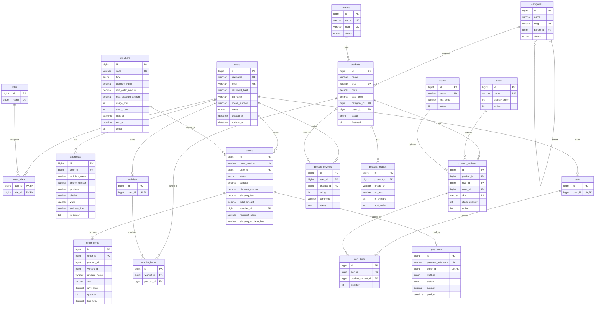

# DatSellerShop Entity-Relationship Diagram

Official schema: 20 active tables. Legacy tables `user`, `customer`, and `category` are not part of this model.

## Relationship summary

| Relationship | Cardinality | Notes |
| --- | --- | --- |
| User ↔ Role | M:N | Join table `user_roles` with composite primary key `(user_id, role_id)` |
| User → Address | 1:N | One default address per user is application-managed |
| Category → Category | 1:N | Optional `parent_id`. Cycle prevention is application-managed |
| Category → Product | 1:N | Required |
| Brand → Product | 1:N | Required |
| Product → ProductVariant | 1:N | Stock lives on the variant, not the product |
| Product → ProductImage | 1:N | One primary image per product is application-managed |
| Size → ProductVariant | 1:N | `size_id` nullable |
| Color → ProductVariant | 1:N | `color_id` nullable |
| User → Cart | 1:1 | Unique `carts.user_id` |
| Cart → CartItem | 1:N | Unique `(cart_id, product_variant_id)` |
| ProductVariant → CartItem | 1:N | Live catalog FK |
| User → Wishlist | 1:1 | Unique `wishlists.user_id` |
| Wishlist → WishlistItem | 1:N | Unique `(wishlist_id, product_id)` |
| Product → WishlistItem | 1:N | Wishlist stores Product, not ProductVariant |
| User → Order | 1:N | Historical; FK is conservative (`NO ACTION`) |
| Order → OrderItem | 1:N | Line items are snapshots |
| Voucher → Order | 1:N | `orders.voucher_id` nullable; voucher fields are also snapshotted |
| Order → Payment | 1:0..1 | Unique `payments.order_id` |
| User → ProductReview | 1:N | Unique `(user_id, product_id)` |
| Product → ProductReview | 1:N | |

`OrderItem.product_id` and `OrderItem.variant_id` are historical scalars. They are not catalog foreign keys, so an order remains readable after catalog changes.

